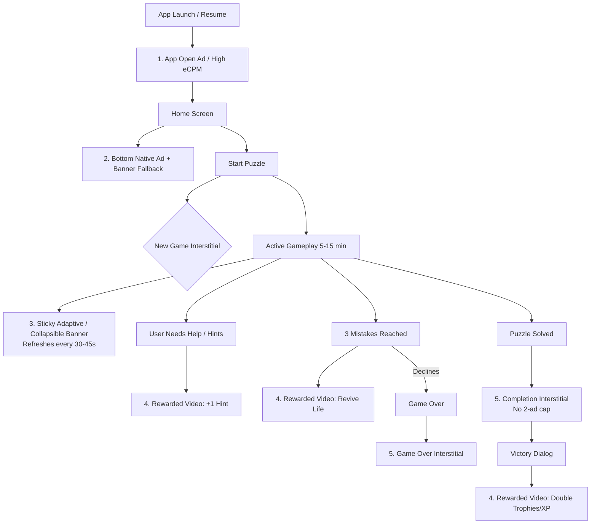

# Aggressive Ads & Monetization Strategy Plan (Sudoku Pro)

**Target Objective:** Maximize Impressions Per User (IPU) and Average Revenue Per User (ARPU) to achieve positive Return On Ad Spend (ROAS) on Google Ads acquisition campaigns, while strictly adhering to Google Play & AdMob policies.

---

## 1. Why The Current Ads Campaign Is Unprofitable

| Current Bottleneck | Current Code State | Revenue Impact |
|---|---|---|
| **Artificial 120s Cooldown** | `cooldownMs = 120 * 1000` across ALL interstitials | Blocks 70%+ of possible interstitial impressions. |
| **Strict 2-Ad Session Cap** | `completionInterstitialsShownThisSession >= 2` | After 2 games, user never sees another completion ad. |
| **Zero Gameplay Banner** | No active banner while solving puzzles (5–15 mins) | Zero revenue during 90% of user screen time. |
| **App Open Ads Disabled** | Completely turned off (`app_open_ads_enabled = false`) | Missing highest-eCPM format ($10–$25+ eCPM). |
| **Excessive Free Hints (3)** | Users start with 3 free hints every game | Very few users ever trigger Rewarded Hint ads. |
| **No Game Over Interstitial** | Only modal shown on 3 mistakes | Misses primary natural exit transition. |

**Current Result:** ~1 to 2 ad impressions per session ≈ **$0.003 - $0.006 revenue/user**.  
If UA CPI is $0.15 - $0.40, the campaign loses money on every install.

---

## 2. The Aggressive Monetization Matrix

To achieve **10x to 15x higher revenue per user**, we activate 5 core ad pillars:

---

## 3. Detailed Action Plan

### Pillar 1: Persistent Gameplay Adaptive Banner
* **Implementation:** Activate `GAMEPLAY_BANNER` anchored to the top or bottom during puzzle solving (below/above header, or bottom below keypad).
* **AdMob Setting:** Enable Google-optimized refresh rate (30–45s).
* **Impact:** A single 10-minute puzzle session delivers **12 to 18 banner impressions**.

### Pillar 2: App Open Ads (Cold Start & Resume)
* **Implementation:** Implement App Open Ad using `@capacitor-community/admob` or native Android plugin.
* **Logic:** 
  - Show on cold start right after splash screen loads.
  - Show on app resume if user has been backgrounded for > 5 minutes.
  - Respect 4-hour frequency cap on App Open Ads to maintain good retention.
* **Impact:** High eCPM ($12–$25) captured immediately from paid acquisition traffic.

### Pillar 3: Unshackle Interstitials (High-Conversion Transitions)
* **Remove Artificial Session Cap:** Eliminate `completionInterstitialsShownThisSession >= 2`.
* **Lower Cooldown:** Reduce global interstitial cooldown from **120 seconds down to 35 seconds**.
* **Game Over Interstitial:** When user hits 3 mistakes and declines Rewarded Rescue, trigger a Game Over interstitial before resetting.
* **Restart / Try Again Interstitial:** Trigger interstitial on game restarts after game over or abandon.
* **Level/Game Completion Interstitial:** Fire on every completed puzzle (if >35s since last ad).

### Pillar 4: Scarcity-Driven Rewarded Ad Economy
* **Reduce Free Starting Hints:**
  - Reduce starting hints from `3` to `1` (or `0` on Medium/Hard).
  - Every hint request thereafter prompts: *"Watch ad for 1 Free Hint"*.
* **Free Undo Scarcity:**
  - Limit free undos to 3 per game; additional undos require watching an ad.
* **Puzzle Auto-Check / Mistake Scan:**
  - Add a "Scan Errors" power-up powered by Rewarded Ad.
* **Completion Double Bonus:**
  - On the Victory modal, add a "2x Score / 2x XP" button that plays a Rewarded Video.

### Pillar 5: Remote Config Dynamic Throttling (Safety & Agility)
All thresholds must be controlled via Firebase Remote Config:
* `fullscreen_ad_cooldown_seconds`: default `35` (was `120`)
* `completion_interstitial_session_cap`: default `999` (unlimited, was `2`)
* `gameplay_banner_enabled`: default `true` (was `false`)
* `app_open_ads_enabled`: default `true` (was `false`)
* `starting_free_hints`: default `1` (was `3`)
* `game_over_interstitial_enabled`: default `true` (new)

---

## 4. Policy Compliance & Account Safety Guardrails
AdMob bans accounts for deceptive ad placement, not for showing ads at compliant natural transitions.
* **No Mid-Game Surprise Popups:** Interstitials ONLY fire on button clicks (New Game, Restart, Exit) or natural state shifts (Game Over, Level Won).
* **Premium Safe Guard:** If user buys "Remove Ads", 100% of banner, native, interstitial, and app open ads are silenced immediately.
* **Clear Rewarded Opt-in:** Rewarded ads must always have clear confirmation and cancel options.

---

## 5. Revenue Projection Comparison

| Metric | Current Passive Setup | Proposed Aggressive Setup |
|---|---|---|
| **Banner Impressions / Session** | 0.5 (Home only) | 12 - 16 (Home Native + Gameplay Banner) |
| **Interstitial Impressions / Session** | 0.4 | 2.5 - 4.0 |
| **Rewarded Views / Session** | 0.1 | 0.8 - 1.5 |
| **App Open Impressions** | 0 | 1.0 |
| **Avg Revenue Per User (ARPU)** | **~$0.005** | **~$0.06 - $0.12** |
| **Campaign ROAS Impact** | **-90% Loss** | **Breakeven to Profitable** |
